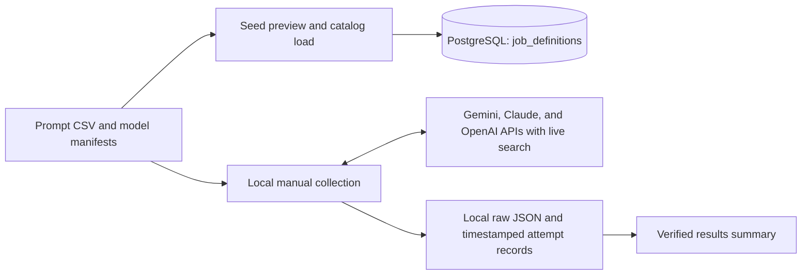
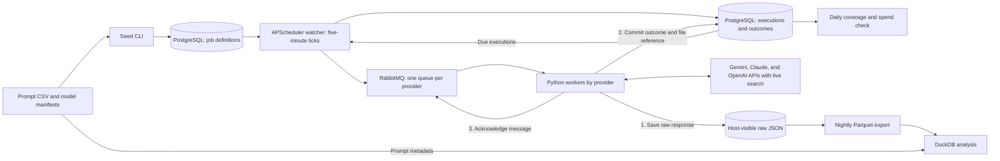

# AI Search and Mental Health Referrals in NYC

This study compares the referrals and sources that Gemini, Claude, and GPT-4o return for matched New York City mental health prompts with live search enabled. The study plan pairs 48 prompts with three model snapshots for 144 scheduled responses. The [collection results](docs/collection-results.md) record completed runs, actual collection times, and differences in request settings.

## Current collection flow

PostgreSQL holds the planned prompt, model, and date assignments. The manual batches use the reviewed assignments and call providers directly. Docker Compose provides PostgreSQL and RabbitMQ locally, and the current batches run independently of RabbitMQ.

| Location | What it stores |
|---|---|
| PostgreSQL `job_definitions` | 144 scheduled job definitions |
| `data/collection/<batch>/<execution>/` | `response.json` with the raw provider response and `attempt.json` with the request, planned date, UTC start and finish times, usage, outcome, and estimated cost |
| `data/collection/<batch>/` | The batch plan and status summary |
| `data/pilot/` | Earlier pilot requests, responses, and usage records |
| [`docs/collection-results.md`](docs/collection-results.md) | Verified progress and budget summary published to GitHub |

The `data/` directory and `.env` are ignored by Git. The collector counts pilot and study attempts against a $9 operating limit within the $10 cap per provider. An uncertain charge stays accounted for until it can be reconciled.

## Planned scheduler and workers

1. **Schedule.** The watcher expands active job definitions into dated executions and publishes due work. A unique key made from the date and run key lets the watcher repeat the expansion without creating duplicate execution rows.
2. **Collect.** Each provider has its own queue and worker pool so it can manage its own rate limits. A worker checks the stored execution, reserves provider budget, and calls the configured search API.
3. **Persist.** The worker saves the raw response first, commits the execution outcome and file reference, then acknowledges the queue message. A redelivered message can check the committed outcome or recover from an existing file. If a provider may have processed a request before the worker could save it, its charge remains uncertain and needs reconciliation before retrying.
4. **Analyze.** The daily check compares expected and completed executions and tracks spend. The nightly export derives `responses`, `search_results`, and `citations` Parquet tables from the raw files. DuckDB joins those tables to the prompt metadata for comparisons by borough, payment condition, and need.

The watcher, execution tables, queue workers, and export are planned. The [design walkthrough](docs/referral-collector-design.html) covers scheduling, failure recovery, and the data model in more detail.
