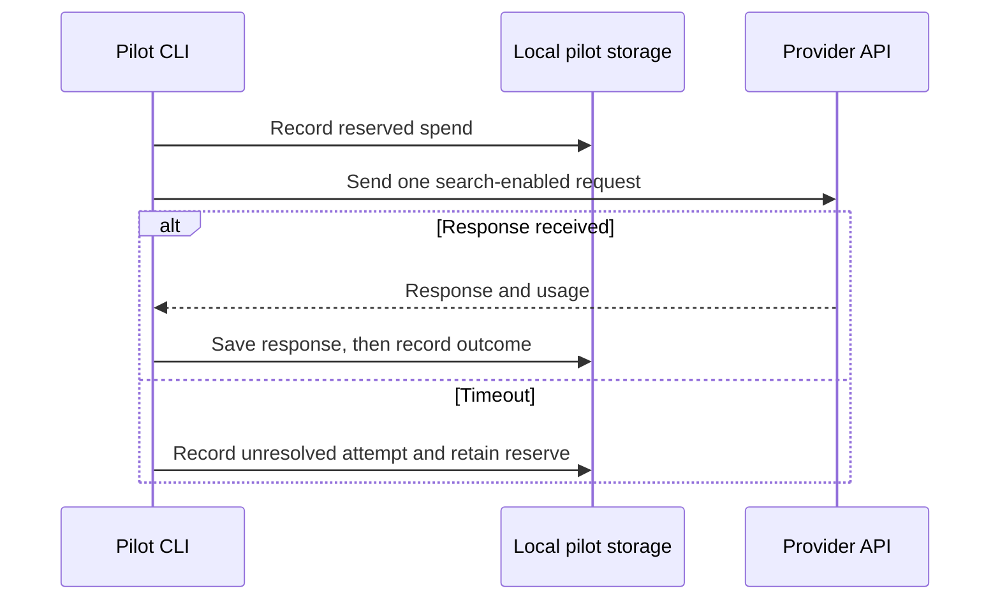

# Live-search pilot · Worked dataflow

## Successful search

This example uses `anc-03` and `gemini-2.5-flash` on an eligible date. The numbers and response fragments below are fixtures.

```text
prompt_id: anc-03
provider: gemini
requested_model: gemini-2.5-flash
request: prompt text plus shared search instruction, with google_search enabled
local response: data/pilot/<run_id>/gemini-2.5-flash.response.json
```

The runner reads the prompt and model row, checks the provider budget, and writes a reservation. It sends one GenerateContent request using the locally configured key. The key stays outside the request record. The runner saves the complete response before deriving any metrics.

```json
{
  "modelVersion": "gemini-2.5-flash",
  "usageMetadata": {
    "promptTokenCount": 180,
    "candidatesTokenCount": 420,
    "thoughtsTokenCount": 120
  },
  "candidates": [{
    "groundingMetadata": {
      "webSearchQueries": ["NYC Bronx uninsured anxiety services"],
      "groundingChunks": [{"web": {"uri": "https://example.com/fixture"}}]
    }
  }]
}
```

The attempt record marks search as observed, records usage and the grounding charge estimate, and releases any unused reserve. A reviewer reads the saved answer and counts referral mentions and citations separately.

## Failure and recovery

If the request times out, preserve the attempt record and its reserve. The provider may have processed the request. The next run leaves that model pending until billing has been checked and an operator explicitly approves another attempt.


