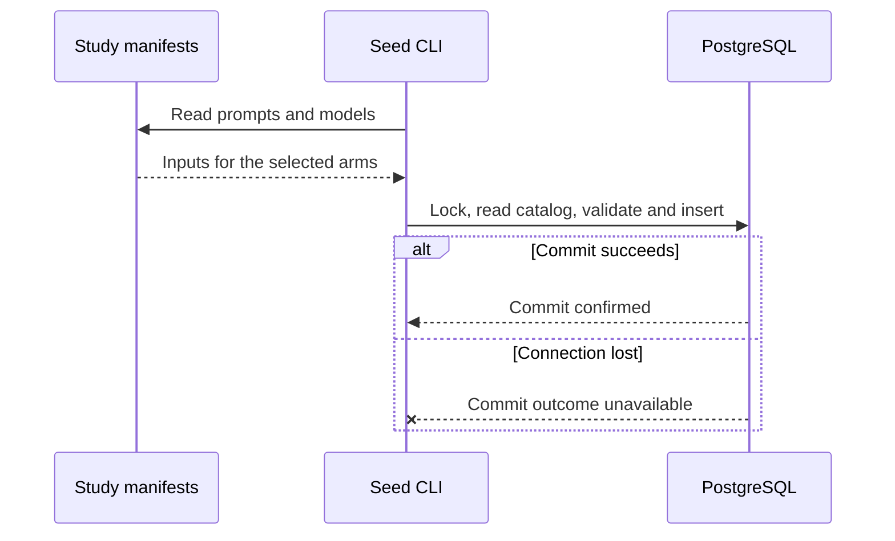

# Seed job definitions · Worked dataflow

## Example

This fixture uses the anchor ID and model label from the walkthrough to demonstrate the catalog shape. The model label is sample data. Treat the production model list and active dates as pending confirmation.

```text
Fixture inputs for --arms daily --start 2026-11-09 --end 2026-12-20
Prompt: anc-03 (anchor)
Model: claude-sonnet-5-5 (anthropic, eligible throughout the fixture)
Task mapping: anthropic → anthropic_search

Candidate job_definitions row:
arm=daily  prompt_id=anc-03  model_id=claude-sonnet-5-5
task_id=anthropic_search  search_enabled=true  schedule_type=DAILY
run_from=2026-11-09  run_until=2026-12-20
```

The loader reads both files, resolves the model's provider to its task ID, and builds the row. An inclusive interval stores this anchor definition once for the 42-day fixture. Each eligible calendar date has the same definition.

```sql
BEGIN;
SET LOCAL lock_timeout = '5s';
LOCK TABLE job_definitions IN SHARE ROW EXCLUSIVE MODE;
SELECT arm, prompt_id, model_id, task_id, schedule_type,
       run_from, run_until, search_enabled
FROM job_definitions;  -- S1, compare keys and intervals in the loader
INSERT INTO job_definitions
  (arm, prompt_id, model_id, task_id, schedule_type,
   run_from, run_until, search_enabled)
VALUES
  ('daily', 'anc-03', 'claude-sonnet-5-5', 'anthropic_search',
   'DAILY', DATE '2026-11-09', DATE '2026-12-20', true);  -- S2
COMMIT;
```

The first invocation reports `inserted=1 unchanged=0`. The same invocation sees an identical stored row and reports `inserted=0 unchanged=1`.

## Failure and recovery

If PostgreSQL disconnects after the insert and before commit, the uncommitted row is rolled back. If the connection drops during commit, the CLI reports a failure because it cannot know whether the commit succeeded. Restore connectivity and rerun with the same files. The row is either inserted or counted as unchanged.


